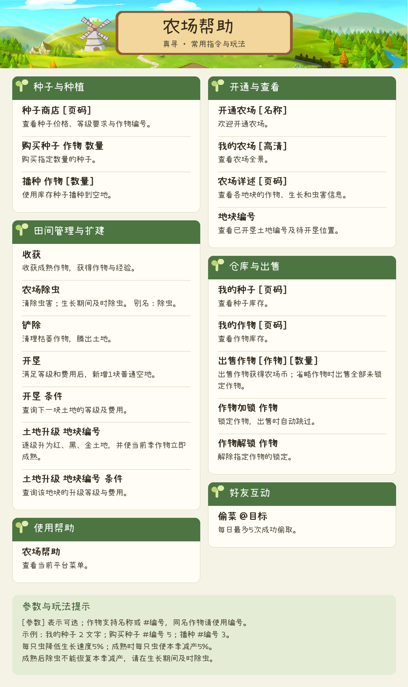

# 真寻农场(zhenxun_plugin_farm)

    
    
    

你是说可以种地对吧🤔?

---
## 目录
- [真寻农场(zhenxun\_plugin\_farm)](#真寻农场zhenxun_plugin_farm)
  - [目录](#目录)
  - [农场界面](#农场界面)
  - [如何安装](#如何安装)
  - [农场帮助](#农场帮助)
  - [待办事宜 `Todo` 列表](#待办事宜-todo-列表)
  - [关于](#关于)
  - [致谢](#致谢)
  - [许可证](#许可证)
  - [上游仓库](#上游仓库)

---

## 农场界面

---

## 如何安装

使用真寻分发仓库的完整生成内容或Actions中的真寻预览包，不能直接
复制主仓库的integrations目录。先停止机器人，备份代码与数据，停用
会注册同名命令的旧插件，再在宿主环境安装本插件requirements.txt。
Pillow要求>=10.4,<11，不强制升级宿主到12。安装后手工启动并检查日志。

默认数据目录为真寻DATA_PATH下的farm_db，新库为farm.sqlite3，日志为
farm-preview.log；旧farm.db不得直接改名覆盖。资源源默认Github，可在
网页配置选择Gitea/farm_service；服务地址独立保留，修改资源源后重载。
图片质量默认75、整数1～95，仅“我的农场 高清”支持高清且质量至少85。
资源或字体下载失败时文字业务仍可用，详细原因见日志。

升级前停机备份完整代码与数据目录；安装器拒绝覆盖，先移走旧目录。
回退需匹配代码和数据库备份，不让旧代码强行打开新schema；恢复旧数据
会丢失备份后进度。卸载时停止加载并移走插件代码，保留数据供恢复。

开发者构建、包验证、安全安装、配置、备份卸载与Secrets详见
[当前维护说明](https://github.com/Shu-Ying/main_plugin_farm/blob/main/docs/zhenxun-preview-current.md)。
本地离线验证不代表真实真寻宿主、公开资源或远端发布已验证。

---

## 农场帮助

---

## 待办事宜 `Todo` 列表

- [x] 完善我的农场图片，例如左上角显示用户数据
- [ ] 完善升级数据、作物数据、作物图片
- [ ] 签到功能
- [x] 作物信息启动时检查更新（Service维护，失败回退已验证缓存）
- [ ] 添加渔场功能
- [ ] 增加活动、交易行功能
- [ ] 增加交易行总行功能
- [ ] 添加其他游戏种子素材
- [ ] 想不到了，想到再说

---

## 关于

本人毫无任何Python经验，也从未正式的、系统的、完整的去学习Python。如有看到写的不对的地方，欢迎指出，也欢迎任何人一起来开发、完善农场。

素材来均源于互联网，侵权请联系我删除

---

## 致谢

最后感谢以下框架/作者的提供的技术支持(排名不分先后):

- [QQ农场](https://qqnc.qq.com/) *绝大多数的素材来源*
- [小赖字体](https://github.com/lxgw/kose-font) *lxgw 提供的开源中文手写字体，采用 SIL OFL 1.1，随包附带完整字体许可*
- [Nonebot2](https://github.com/nonebot/nonebot2) *✨ 跨平台 Python 异步机器人框架 ✨*
- [zhenxun_bot](https://github.com/zhenxun-org/zhenxun_bot) *最爱真寻的一集*
- [HibiKier](https://github.com/HibiKier) *阿咪为什么是神*
- [ATTomato](https://github.com/ATTomatoo) *流泪偷码头.jpg*
- [ChatGPT](https://chatgpt.com/) *AI神力*

## 许可证

`真寻农场(zhenxun_plugin_farm)`将采用的是`GPLv3`许可证进行开源

默认使用的小赖字体由 farm_service 分发，单独遵循 `SIL OFL 1.1`，完整版权声明与许可见
[OFL-Xiaolai.txt](./_vendor/farm_render/data/OFL-Xiaolai.txt)。

## 上游仓库

- [main_plugin_farm](https://github.com/Shu-Ying/main_plugin_farm)
